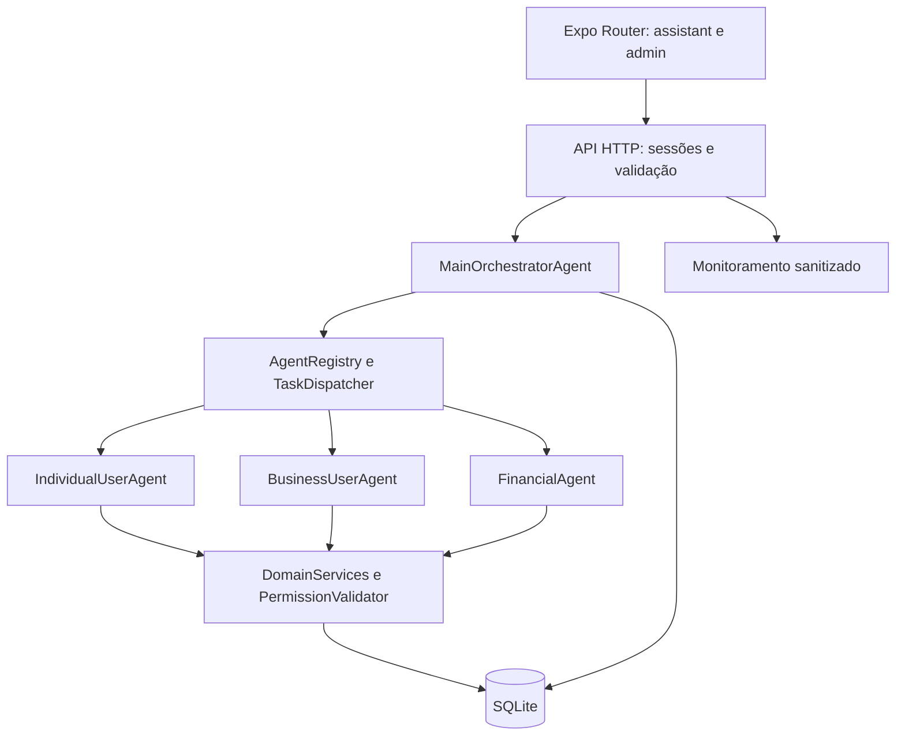

# Assistente multiagente — demonstração funcional

Esta extensão do BB-APP executa consultas e uma atualização confirmada sobre **dados fictícios persistidos em SQLite**, por uma API HTTP local. Não há integração bancária nem LLM conectado. O antigo Inspetor continua disponível como laboratório de políticas; Atlas e Nina continuam pertencendo ao simulador. O novo agente empresarial consulta pessoa jurídica e não fornece orientação jurídica.

A [análise anterior à implementação](multiagente-analise.md) descreve a arquitetura encontrada e as decisões iniciais. A documentação PDF anterior descreve a versão prévia do produto; este documento é o complemento da implementação multiagente.

## Executar

Node.js >=22.13 (Node 24 usado na validação), dependências instaladas com `npm ci`:

```sh
npm run dev:web
```

Inicia a API em `http://127.0.0.1:8090` e Expo/Metro. Abra a URL web informada pelo Expo, normalmente `http://localhost:8081`. Na Home, toque **Conversar com o bot principal** → **Entrar como usuário de demonstração**. Também é possível abrir `/assistant` diretamente na web.

Para iniciar separadamente, execute `npm run server` em um terminal e `npm run web` em outro. `npm start` continua iniciando somente o Expo, preservando o fluxo anterior para a Home e o Inspetor. O chat precisa da API ligada.

No celular, use `npm run dev`. Android emulador usa `10.0.2.2:8090` por padrão; iOS/web usam `localhost:8090`. Em aparelho físico, configure `.env.local` com `ASSISTANT_HOST=0.0.0.0` e `EXPO_PUBLIC_ASSISTANT_API_URL=http://IP_LAN_DO_COMPUTADOR:8090`, reinicie Expo/API e permita a porta na rede local. Use somente uma rede de demonstração confiável. As dependências Expo Router foram instaladas com o resolvedor do SDK 57. Não foram criadas pastas nativas.

## Roteiro da apresentação

| Pedido | Execução | Resultado |
| --- | --- | --- |
| Quero consultar meu resumo financeiro. | FinancialAgent | 5 movimentos; receitas R$ 5.550,00; despesas R$ 414,22; saldo final R$ 4.850,75 |
| Quero verificar os dados do meu cadastro. | IndividualUserAgent | Nome do próprio usuário e categoria demonstrativa |
| Quero consultar as informações da minha empresa. | BusinessUserAgent | Empresa fictícia vinculada, referência DEMO-PJ-001 |
| Preciso de um resumo financeiro da minha empresa. | BusinessUserAgent → FinancialAgent | Vínculo verificado antes dos cálculos; saldo inicial R$ 10.000,00, receitas R$ 4.250,00, despesas R$ 1.750,00, saldo final R$ 12.500,00 |

O resumo considera todos os movimentos da base, sem prometer um período mensal. A conta individual é derivada dos mesmos fixtures da Home; o saldo inicial é ajustado ao instantâneo já existente, sem inventar transações. O cadastro e o livro financeiro passam a ser consultados no servidor, sem alterar os cards estáticos preexistentes da Home.

Abra **Ver detalhes da execução** para conferir agentes, ordem, operações, estado, duração medida e correlação. Solicitações incompletas pedem esclarecimento. Transferências, pagamentos, exclusões e acesso a terceiros são recusados sem ferramentas. Para demonstrar uma escrita real no SQLite:

1. Envie `Alterar meu nome para Maria Silva`.
2. Confira a proposta: o nome ainda não foi alterado.
3. Toque **Confirmar alteração do nome** ou **Cancelar proposta**. A proposta expira em cinco minutos.
4. Consulte `Meu cadastro` para verificar o resultado. A Home permanece um protótipo de conta estático, conforme a arquitetura anterior.

O histórico é persistido no servidor. Ao recarregar, entre novamente e selecione uma conversa. A identidade `demo-user` é compartilhada por todos que usam o botão de demonstração; não insira dados pessoais reais. Sessões não são armazenadas no navegador/AsyncStorage e expiram em uma hora. O backend não aceita um ID de usuário enviado pelo frontend ou por um modelo.

## Administração

Abra `/admin` (ou **Acesso administrativo** antes de entrar no chat). Use a senha temporária exibida no terminal do backend; alternativamente, defina `ASSISTANT_ADMIN_PASSWORD` em `.env.local`. Não há senha fixa no código ou variável pública com segredo. Administrador e usuário são papéis distintos: administrador não acessa os perfis nem as conversas privadas por essa sessão.

O painel mostra registro, capacidades, contratos, autorização, habilitação, histórico de até 100 execuções recentes, etapas, correlações, durações e auditoria técnica. O botão **Atualizar monitoramento** consulta o estado atual do servidor. A habilitação é persistida no banco; agentes desabilitados produzem erro controlado e interrompem etapas dependentes. O painel recebe apenas metadados: mensagens, nomes, valores, resultados privados e detalhes livres de erro não são incluídos na resposta administrativa. O Inspetor anterior continua como simulação local, sem conceder privilégios administrativos para a nova API.

## Arquitetura e arquivos



| Arquivo/módulo | Responsabilidade |
| --- | --- |
| `server/index.ts` | Configuração, banco, senha gerada e encerramento |
| `server/http.ts` | Rotas, sessões, CORS, limites, validação JSON e erros seguros |
| `server/store.ts` | Schema, fixtures, histórico, persistência e recuperação |
| `server/services.ts` | Serviços reais de consulta, autorização e escrita transacional |
| `server/agents.ts` | Três especialistas independentes, registro e dispatcher |
| `server/routing.ts` | Regras determinísticas e interface IntentProvider |
| `server/orchestrator.ts` | Planejamento, dependências, cancelamento e respostas |
| `src/features/assistant/contracts.ts` | Contratos de tarefa/resultado/exibição compartilhados |
| `src/features/assistant/client.ts` | Cliente HTTP com timeout; sem segredos |
| `src/features/assistant/AssistantProvider.tsx` | Sessão em memória |
| `src/features/assistant/AssistantScreen.tsx` | Chat, histórico, resultados e confirmações |
| `src/features/assistant/MonitoringScreen.tsx` | Entrada administrativa e monitoramento |
| `src/app/{_layout,index,assistant,admin}.tsx` | Rotas Expo Router e Home preservada |
| `server/tests/integration.test.ts` | Integração HTTP/SQLite e segurança |
| `tests/assistant.spec.ts` | Fluxos de interface desktop/celular |
| `scripts/dev.cjs`, `.env.example` | Inicialização e configuração |

Modificados: `App.tsx` (providers), `index.ts` (entrada Router), `src/screens/HomeScreen.tsx` (atalho), `app.json` (scheme/plugin), `package.json`/lock (Router, patch Expo 57.0.28 e comandos), `tsconfig.json` (imports TypeScript do Node e exclusão de artefatos gerados), `playwright.config.ts` (API de teste) e README. Alterações locais anteriores em Inspetor/documentação não foram revertidas.

SQLite contém usuários, empresas, associações, contas/saldos iniciais, movimentos em centavos inteiros, conversas, execuções, propostas de confirmação, estado dos agentes e auditoria. SQL usa parâmetros vinculados. A confirmação atualiza perfil, proposta, execução e auditoria na mesma transação. Uma resposta perdida pode ser repetida com a mesma confirmação sem nova escrita. `Idempotency-Key` é único por usuário e validado contra conversa/mensagem; reaproveitar com outro conteúdo retorna 409. O cliente mantém a chave durante uma repetição após falha de rede.

O dispatcher valida disponibilidade, capacidade e formato dos resultados. Os planos são finitos, sem transferência recursiva entre agentes, com até quatro etapas e oito segundos por execução. Operações atuais são sequenciais; o fluxo PJ depende do resultado empresarial. Cancelamento e timeout interrompem a espera e invalidam o resultado; integrações futuras devem respeitar `AbortSignal` antes de qualquer efeito colateral. As consultas atuais são SQLite síncrono e a única escrita é uma confirmação separada e transacional. Ao reiniciar o servidor, execuções que ficaram em andamento são marcadas como interrompidas e nunca repetidas automaticamente.

Para adicionar agentes, implemente `Agent`, registre a instância e adicione uma intenção/plano tipado. O orquestrador não precisa reimplementar o loop de execução. Para integrar IA posteriormente, injete `IntentProvider` em `createApplication`. O contrato aceita somente `{ intent, confidence }` para intenções de consulta permitidas, com confiança >=0,9; IDs, ações e texto livre de sucesso não são aceitos. Regras conhecidas e sensíveis prevalecem sobre o provedor. Timeout de interpretação: 1,5 segundo, seguido de contingência determinística. Nenhum adaptador para serviço externo está conectado neste MVP.

## API

| Método e caminho | Acesso |
| --- | --- |
| `GET /health` | Público, informa modo demonstrativo |
| `POST /sessions/demo` | Identidade fictícia comum, corpo `{}` |
| `POST /sessions/admin` | Senha administrativa, corpo `{password}` |
| `DELETE /sessions/current` | Revoga bearer token atual |
| `GET /conversations`, `POST /conversations` | Usuário individual autenticado |
| `GET /conversations/:id/messages` | Titular da conversa |
| `POST /conversations/:id/messages` | Titular, `{message}`, header `Idempotency-Key`; retorna 202 |
| `GET /executions/:id` | Titular, estado/etapas reais |
| `POST /executions/:id/cancel` | Titular, `{}` |
| `POST /confirmations/:id` | Titular, `{confirmed:true}` |
| `GET /admin/monitoring` | Somente admin, resposta sanitizada |
| `PATCH /admin/agents/:id` | Somente admin, `{enabled:boolean}` |

Limites: 2.000 caracteres por mensagem, 8 KiB por corpo, 30 mensagens/minuto/usuário, 100 solicitações por conversa, 20 execuções simultâneas globais, cinco tentativas de login admin/minuto/IP. Validação de chaves desconhecidas e permissões ocorre antes da execução. O modelo não define identidade, empresa, SQL, comando ou autorização. Estes controles demonstram isolamento e minimização; não constituem certificação LGPD.

## Variáveis

Todas são opcionais. Use `.env.local` (ignorado pelo Git) para substituir os padrões. Expo carrega as variáveis públicas; os scripts `server` e `dev` carregam o mesmo arquivo para Node.

| Variável | Padrão / uso |
| --- | --- |
| `EXPO_PUBLIC_ASSISTANT_API_URL` | localhost:8090 na web/iOS; 10.0.2.2:8090 no Android emulador |
| `ASSISTANT_HOST` | 127.0.0.1 |
| `ASSISTANT_PORT` | 8090 |
| `ASSISTANT_DB_PATH` | .cache/assistant/demo.sqlite |
| `ASSISTANT_ADMIN_PASSWORD` | Gerada em cada início se ausente; nunca pública |
| `ASSISTANT_ALLOWED_ORIGINS` | localhost:8081 e 127.0.0.1:8081, separados por vírgula |
| `ASSISTANT_DEMO_MODE` | Demonstração; `false` impede inicialização |

## Validação

```sh
npm run check
npm run test:agents
npm run test:engine
npm run test:e2e
npm run export:web
```

`test:agents` testa HTTP real em porta temporária e SQLite real, incluindo persistência em arquivo/reabertura. Não precisa de navegador ou provedor. A suíte cobre os quatro encaminhamentos/ordem, acesso a terceiros, admin, falhas, contingência, ausência de sucesso falso, persistência, ambiguidade, confirmação/autorização/expiração/cancelamento, idempotência, timeout, origem e rate limiting. A suíte Playwright acrescenta chat/admin e conserva os testes preexistentes da Home, Inspetor e responsividade. A API de teste tem banco isolado e senha aleatória; não usa o banco de apresentação.

`npm run check` inclui TypeScript, lint Expo da interface e `lint:server` para backend, inicialização e novos testes. Artefatos `dist/`, caches e relatórios ficam fora da análise TypeScript; o bundle minificado não deve ser tratado como código-fonte.

Resultados efetivamente executados serão registrados em `multiagente-validacao.md` ao fim da validação.

## Limites e pendências externas

Servidor deliberadamente exclusivo de demonstração: não inicia com `NODE_ENV=production` ou modo demo desativado. Antes de produção, são necessários identidade real/SSO, gestão de organizações, TLS, armazenamento/backup apropriados, política de retenção/eliminação e revisão de segurança do ambiente. A conta demo aberta não é autenticação para clientes reais. Não há banco/meio de pagamento, CNPJ real, OAuth ou modelo externo conectado; nenhuma chave de IA é necessária agora. Integração futura exige adaptador de provedor e credenciais somente no backend.

Validação web não comprova funcionamento em dispositivos Android/iOS físicos, assinatura, build EAS, publicação ou comportamento sob carga. A auditoria de dependências ainda tem alertas no ecossistema Expo/Metro/Router, detalhados no relatório de validação; sua revisão é pendente antes de produção. A documentação PDF anterior não foi regenerada, para preservar o artefato aberto e as alterações de documentação existentes.
